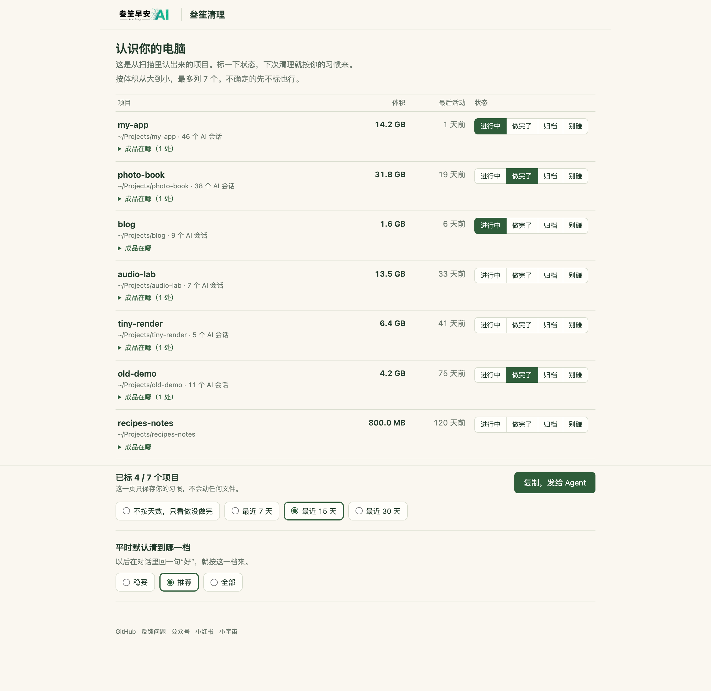
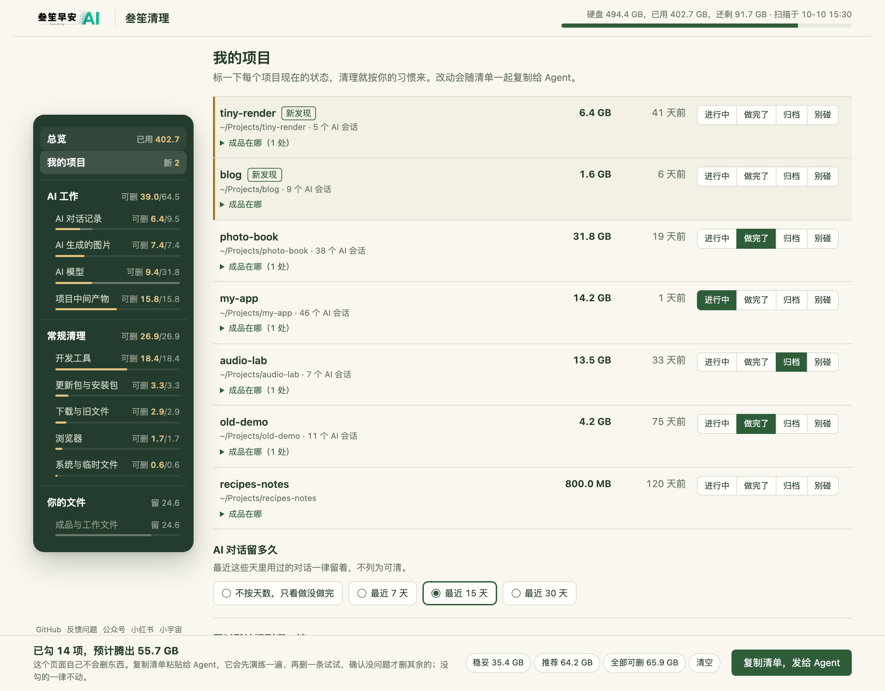
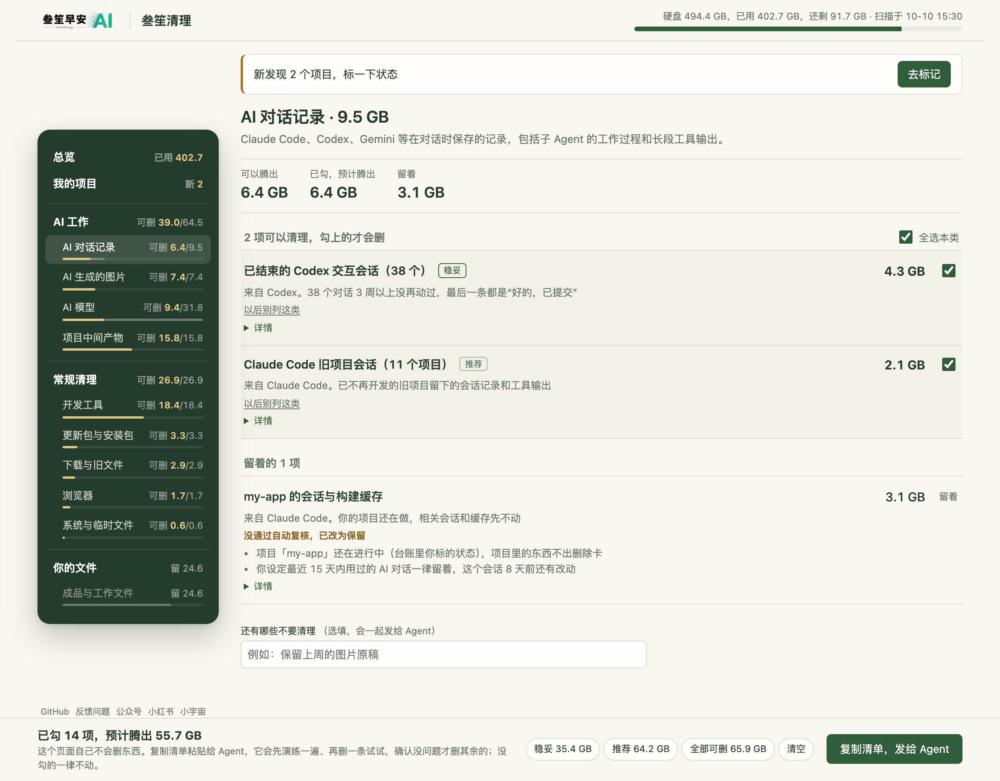
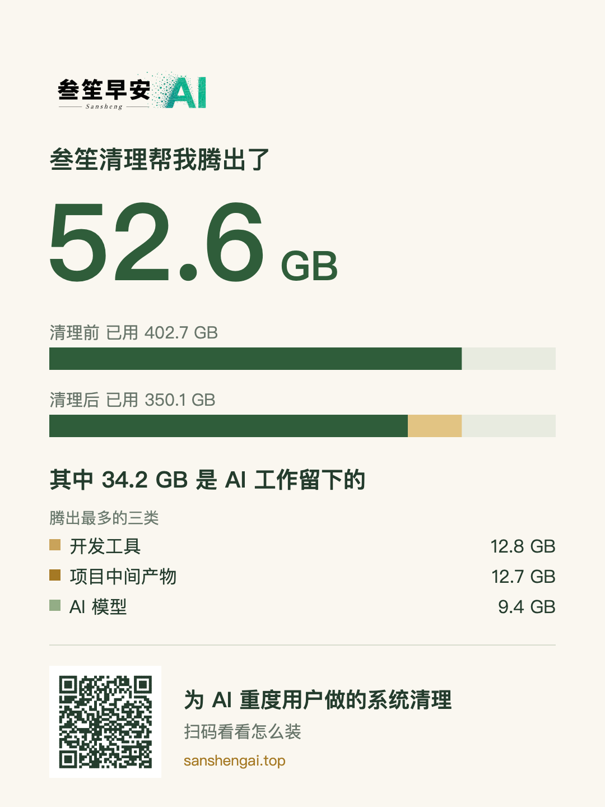
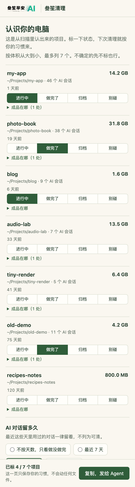

# sansheng-disk-cleanup · 叁笙清理

给 AI 重度用户的 macOS 磁盘清理 Skill。它认得 Agent 会话、批量出图、工作树中间稿、模型缓存这些 AI 工作留下的大头，讲清每一项为什么能删、删了会怎样；第一次使用先花一分钟让它认识你的项目，之后你在对话里回一句“好”（或在看板上勾选），它就先预演、再试删一条、再正式清理，最后给你一页成果。

中文说明在前，English overview 在文末。当前版本 0.5.0，仅支持 macOS；Windows 尚未支持。


## 安装

**最省事：把这句话发给你的 AI**（Claude Code、Codex 等支持 `SKILL.md` 的 Agent）：

```text
请从 https://github.com/sanshengai/sansheng-disk-cleanup 安装这个 Skill，然后帮我看看磁盘空间都去哪了。
```

也可以自己克隆到 Agent 的 Skill 目录，例如 Claude Code：

```sh
git clone https://github.com/sanshengai/sansheng-disk-cleanup ~/.claude/skills/sansheng-disk-cleanup
```

需要 Python 3.9 及以上，只用标准库；装有 `rg` 时引用检查更快、更全。

## 亮点

1. **为 AI 重度用户而生**：认得 Codex、Claude Code 等 Agent 的会话与出图、流水线中间稿、工作树、模型权重、模拟器和 SDK，知道每一项是哪个任务产生的、任务结束没有。18 张知识卡，各家软件的位置和规矩写在卡里，不靠猜。
2. **敢清大头**：常规工具只敢动缓存；它能分清“这是废稿还是作品”，所以真正的大占用也能处理。落在大目录深处的条目会按自身路径，在你的成品目录和所在 git 仓里逐条补查有没有被文档引用；被引用的自动留下，没查过的不会当成没人用。
3. **一句话就清**：大多数时候不用开网页勾选。它给出“稳妥 / 推荐 / 全部可删”三档和一段说明，你回一句就开始；第一次使用或要你拿主意的事情多时，才发一张离线看板。
4. **先认识你的项目，越用越懂你**：第一次使用分两段——先发一张“项目台账”看板，把扫描认出的项目列给你，你给每个标一个状态（进行中 / 做完了 / 归档 / 别碰），一分钟点完，再开始清理。进行中和“别碰”的项目里的东西不会出删除卡；做完了的项目，相关待决定项会先替你勾上（仍要你确认）。第二次起只问新出现的项目；同一类东西你连续三次做了同样的选择，才问一次“以后都这样吗”。台账和规则只存在本机。
5. **看板选完一条命令走完**：在看板上勾好、点“复制清单”发给 Agent，它用一条命令完成校验、预演、试点、正式执行，并自动生成成果页；清单被改过或与封存对不上，什么都不会删。
6. **安全有底**：先预演、再试删一条、再正式删，每一步都逐项复核；凭证、记忆、当前会话、未提交的代码、聊天记录由脚本强制保护，Agent 也放行不了；不 `rm -rf`，不用 sudo，不装常驻程序。
7. **清完有成果、能治本**：自动生成成果页——实测腾出多少、清理前后对比、各类占比、其中 AI 工作留下的部分；告诉你让盘反复变满的源头设置怎么改。可一键存一张分享图，二维码只带几个汇总数字。
8. **认不出的目录，可以反馈**：遇到体积不小、却没有知识卡也没被规则认出的目录，它可以生成一份不含个人信息的反馈文字（用户名换成 `~`，不含文件名、文件内容和项目名），你看过预览、愿意的话，用预填好的 GitHub Issue 链接提交，或到[官网反馈页](https://sanshengai.top/tools/disk-cleanup/feedback/)；它绝不会自动发送任何东西。

### 看看长什么样

以下截图用的是虚构的示例数据（示例用户 alex、示例项目 my-app / photo-book / blog，494 GB 的盘），界面由真实模板渲染。

| ① 第一次：认识你的项目 | ② 清理看板总览 |
|---|---|
|  |  |
| **看板里的“我的项目”** | **没通过复核的卡：原因一眼看懂** |
|  |  |
| **清理完的成果页** | **分享图** |
|  |  |

手机上同样可看（示例）：

 


## 为什么需要它

常规清理工具找的是浏览器缓存、日志、废纸篓，经常用 AI 工具的电脑上，大头却在别处：

- **Agent 会话**：比如用 `codex exec` 批量出图，同一张图会存三份——原图、会话记录、历史数据库各一份。每个会话只有几 MB，按大小排序永远排不到前面，累积起来却有几十 GB。
- **流水线中间稿**：视频分镜、配图小样、试画废稿、构建输出、多棵工作树里的临时产物。
- **模型与工具链**：模型权重、模拟器镜像、SDK、各种包缓存和旧版本程序。

这些东西不能看"多久没动""名字里有 cache"就删。本 Skill 让 Agent 对每个大占用回答四个问题：**谁产生的、为哪个任务、任务结束没有、现在还有谁在用**。四个问题都有证据才建议清理，缺一项就变成一句问你的话。

## 工作方式

```
（第一次）probe projects → plan.py onboard：项目台账看板 → 你标项目状态
scan.py 采集事实 → Agent 判断并写清理计划 → plan.py 校验、封存、给出三档 → 你回一句（或在看板上选） → act.py 预演、试删、正式执行 → 成果页
```

0. **认识项目**（第一次使用，或出现新项目时）：`probe projects` 认出 git 仓库、AI 会话的工作目录和成品目录，生成只有项目表、没有任何删除选项的台账看板；你标好状态回传，保存在本机 `profile.json`。之后每次判断都按台账来：进行中、别碰的项目不细查，做完了、归档的才查中间稿、会话和构建产物。
1. **扫描**（只读）：自顶向下统计大目录，附上 git 角色、是否被进程打开、24 小时内的改动、是否被其他文件引用、与上次扫描相比的增长。针对 Codex、Claude Code、Android、工作树、Grok 有专项探针，也能看 macOS 系统层（本地快照、系统数据、完全磁盘访问权限）、软件更新暂存、已卸载软件的遗留目录，以及下载、桌面、文稿、影片里长期不动的大文件；Codex 会话可以按来源归组，并逐个用哈希核对图片是否已经另存。
2. **判断**：Agent 读对应的知识卡（18 张，覆盖各家 AI Agent、模型缓存、包管理器、Android、Xcode、Docker、工作树与流水线、macOS 系统、浏览器、更新与安装包、剪辑设计音乐游戏、聊天与网盘、长期不用的大文件），写出清理计划。
3. **校验与提案**：脚本校验计划，证据不足、正在使用、被引用却没说明、路径受保护的条目，一律自动降为“保留”并写明原因。通过的计划会封存，并给出三档提案和一段发给你的话；第一次使用或待你决定的超过 3 项时，再生成一张离线看板。
4. **执行**：只执行你选的那一档或看板上选中的卡片。顺序是先预演，再试删一条，然后正式执行，任何一步异常就停。看板清单用 `act.py go --from-board` 一条命令走完，对话里确认的用 `act.py go --choice`。执行前逐项复核：路径还是封存时那一个、不在保护名单、没有被打开、24 小时内没改动、不删 git 跟踪的文件。能用工具自带命令的，优先用自带命令（如 `codex delete`、`sdkmanager --uninstall`、`brew cleanup`）。
5. **成果**：按条目核算实测释放量，同时给出磁盘余量的变化，自动生成成果页和分享图。你的选择会记在本机，用来下次少问一句。遇到认不出来源的大目录，会在最后问你要不要生成反馈（只生成文字，不自动发送）。

## 安全边界

- 不安装常驻程序，不设定时任务，不用 sudo，不上传任何东西。
- 凭证、记忆、当前会话、未提交的源码、正在写入的数据库，由脚本强制保护，Agent 无法放行。
- 聊天软件（微信、企业微信等）的记录不直接删除，只引导你用软件自带的清理入口。
- 删除逐个文件进行，不用 `rm -rf`，不跟随符号链接。
- 工具自带的保留设置（如会话保留天数）只作为建议列出，需要你同意后才修改。

## 快速使用

加载本 Skill 后，说“帮我清理一下磁盘”或“磁盘快满了”。Agent 会按 [SKILL.md](SKILL.md) 的流程扫描，然后在对话里给你三档选择。

也可以手动运行各步骤：

```sh
python3 scripts/scan.py probe projects --run <run目录>  # 第一次：认出你的项目
python3 scripts/plan.py onboard --run <run目录>      # 第一次：生成项目台账看板
python3 scripts/scan.py scan                         # 结果写到 ~/.sansheng/disk-cleanup/runs/<scan_id>/
python3 scripts/scan.py probe codex-groups           # Codex 会话按来源归组
python3 scripts/scan.py probe item-refs --run <run目录>  # 大目录内部条目逐条查引用
python3 scripts/scan.py probe bigfiles               # 下载、桌面等处长期不用的大文件
python3 scripts/plan.py check   --run <run目录>       # Agent 写好 plan.json 之后
python3 scripts/plan.py seal    --run <run目录>
python3 scripts/plan.py propose --run <run目录>       # 三档提案与一段说明
python3 scripts/plan.py board   --run <run目录>       # 提案说要发看板时，生成 board.html
python3 scripts/act.py go --run <run目录> --choice recommended   # 预演 → 试删 → 正式执行 → 成果页
python3 scripts/act.py go --run <run目录> --from-board <清单文件>  # 看板路径：校验 → 保存设置与台账 → 预演 → 试删 → 正式执行 → 成果页
python3 scripts/feedback.py gaps --run <run目录>      # 认不出来源的大目录：只生成反馈文字，不发送
```

本机的设置、项目台账与习惯规则（项目状态与成品目录、额外的引用检查目录、追加的保护路径、对话保留天数、默认档位、自建流水线说明）写在 `~/.sansheng/disk-cleanup/profile.json`，不放进 Skill 本体。格式见 [references/contract.md](references/contract.md)。

## 文档

- [SKILL.md](SKILL.md)：Agent 的操作流程与硬约束
- [references/judgment.md](references/judgment.md)：判断一个大目录能不能清的规则
- [references/cards/](references/cards/)：各类对象的知识卡
- [references/contract.md](references/contract.md)：各步骤的数据格式与脚本行为
- [CHANGELOG.md](CHANGELOG.md)：版本变化

## 关于作者与许可

由[叁笙早安 AI](https://sanshengai.top)开发，来自真实的磁盘调查需求。

代码与随附文档采用 [MIT License](LICENSE)。内置的二维码编码库 `scripts/vendor/qrcodegen.py` 来自 [Project Nayuki](https://www.nayuki.io/page/qr-code-generator-library)（MIT），保留原版权声明。正式 Logo 与品牌权利单独保留，随原始 Skill 和生成的看板显示、再分发 Logo 的范围见 [品牌说明](BRAND.md)。

## English overview

A macOS disk-cleanup Skill for heavy AI-tool users. Besides ordinary caches, it targets what AI workflows leave behind: Agent sessions (e.g. batch image generation with `codex exec` stores each image three times), pipeline intermediates, build outputs, worktrees, model weights, simulators and SDKs, plus the macOS system layer, common apps and large files left untouched for months in Downloads, Desktop, Documents and Movies.

Install by telling your agent: `Please install the Skill from https://github.com/sanshengai/sansheng-disk-cleanup and show me where my disk space went.`

`scan.py` collects facts only (sizes, git role, open files, recent changes, references, growth). The Agent judges each large item by four questions (who produced it, for which task, is the task finished, who still uses it) using 18 bundled knowledge cards, and writes a plan. `plan.py` validates and seals the plan; items lacking evidence are automatically downgraded to "keep". It then proposes three tiers (safe / recommended / all) so you can answer in one sentence; an offline dashboard is only generated for first-time use or when several items need your decision. `act.py go` runs a dry run, a one-item pilot and the full run, re-verifying every item and preferring native tool commands, then renders a results page with a shareable image. Your choices are remembered locally; after three identical decisions on the same kind of item it asks once whether to make it a rule. Credentials, memories, live sessions, uncommitted source and chat histories are always protected. No daemons, no sudo, nothing uploaded.

New in 0.5: **a two-stage first run** -- it first lists the projects it found (size, last activity, AI sessions) in an offline "project ledger" board and you mark each one as active / done / archived / hands-off (or skip), then it cleans. **The ledger grows with use**: active and hands-off projects never get delete cards, items of finished projects come pre-ticked (you still confirm), and from the second run on it only asks about new projects. **One command from the board**: `act.py go --from-board <exported text>` validates the list, saves settings, re-seals if needed, then runs dry run, pilot and full run and generates the results page; a tampered or mismatched list is rejected before anything is deleted. **Unrecognized large folders can be reported without personal data**: `scripts/feedback.py` writes a redacted summary (user name replaced by `~`, no file names, contents or project names) that you can submit through a pre-filled GitHub Issue link or the [feedback page](https://sanshengai.top/tools/disk-cleanup/feedback/); it never sends anything by itself.

Version 0.5.0, macOS only. Code is MIT-licensed; the logo is covered separately by [BRAND.md](BRAND.md).

好用的话，欢迎去 GitHub 点个 Star。If it helps, a GitHub Star is welcome.
