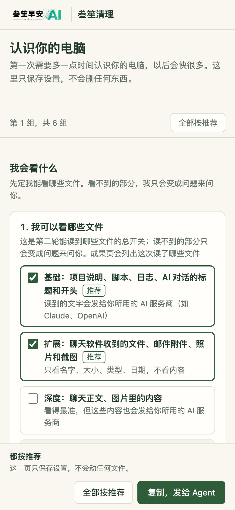

# sansheng-disk-cleanup · 叁笙清理

**会读懂你的电脑的 macOS 磁盘清理 Skill**：认得 AI 工作留下的东西，认不出的大目录会先去调查“这是谁、为哪个任务留下的”，第一次用一页选择题认识你，以后越用越懂你。

中文说明在前，English overview 在文末。当前版本 0.6.0，仅支持 macOS；Windows 尚未支持。


*第一次使用只需要答这一页（示例数据）：它先看一遍你的电脑，再带着看到的东西来问你。可以一键“全部按推荐”，以后不再出现。*

## 和普通清理软件有什么不同

1. **它会自己去调查。** 认不出的大目录，它不会只按清单匹配，而是去看里面是什么、是谁留下的、为哪个任务，查清楚了记下来，下次直接认得。
2. **它认得 AI 工作留下的东西。** AI 对话记录、批量出图（同一张图常常存三份：原图、会话记录、历史数据库各一份）、工作树和构建产物，是 AI 重度用户最大的占用来源，常规清理软件只清得到表面。
3. **它记得你的习惯，越用越懂你。** 第一次用一页选择题认识你的电脑；每次清理后告诉你“这次我记住了”，哪条不对，随手划掉就忘掉。

## 第一次怎么用

1. **快速看一遍**：先扫一遍电脑，约 1 分钟，认出装了哪些工具、有哪些项目。
2. **一页选择题**：按你的电脑出题（没装 Docker 就不问 Docker）。AI 重度用户大约 5 分钟，也可以一键全部按推荐；想改随时对它说“改设置”。
3. **再深入看**：按你的回答去读该读的文件、查完成的证据，常用的工具和进行中的项目会跳过。
4. **清理看板**：把能清的、要你拿主意的列出来，每项写清依据和后果。
5. **成果页**：腾出多少、这次读了哪些文件、这次我记住了什么、从源头改好了什么。

以后每次：扫描 → 清理看板（或在对话里回一句“好”）→ 成果页。

## 安装

如果觉得这个 Skill 有用，请先到 [GitHub 仓库](https://github.com/sanshengai/sansheng-disk-cleanup) 点个 Star，这对独立开发者是很大的鼓励。

**最省事：把这句话发给你的 AI**（Claude Code、Codex 等支持 `SKILL.md` 的 Agent）：

```text
请从 https://github.com/sanshengai/sansheng-disk-cleanup 安装这个 Skill，然后帮我看看磁盘空间都去哪了。
```

也可以自己克隆到 Agent 的 Skill 目录，例如 Claude Code：

```sh
git clone https://github.com/sanshengai/sansheng-disk-cleanup ~/.claude/skills/sansheng-disk-cleanup
```

需要 Python 3.9 及以上，只用标准库；装有 `rg` 时引用检查更快、更全。GitHub 打不开时，可以到[官网](https://sanshengai.top)下载备用安装包。

## 亮点

1. **你决定它能看什么**：四档读取范围——基础（项目说明、脚本、日志）、扩展（聊天软件收到的文件、邮件附件、照片截图，只看名字和大小）、深度（聊天正文、图片内容）、永不读（密码、钥匙串、浏览器登录数据、密钥，由脚本强制，不能勾掉）。读到的内容会发给你所用的 AI 服务商，所以每次成果页都列出这次读了哪些文件。
2. **删和留之外的第三条路**：删掉的东西可以先放进废纸篓（能反悔）；做完的项目可以搬到外接硬盘，逐个文件校验一致后才处理原文件；iCloud 和网盘里已下载的文件夹，只给“只留云端”的官方做法，不动你的文件。
3. **治本，不只是再删一次**：发现会一直涨的东西（AI 工具一直存对话、脚本每次重复存图），经你同意从源头改，改动可以撤销，下次清理告诉你是不是真的停了。
4. **一句话就清**：大多数时候不用开网页勾选，它给出“稳妥 / 推荐 / 全部可删”三档和一段说明，你回一句就开始；要你拿主意的事情多时才发看板，勾好后一条命令走完预演、试点、正式执行和成果页。
5. **安全不变**：你的设置和它的记忆只改变“问不问、预填什么、默认勾到哪”，**不改变能不能删**。能不能删，仍要逐项核对证据、引用、进程和 24 小时内的改动；删除前先预演、再试删一条、才正式执行；凭证、记忆、当前会话、未提交的代码、聊天记录由脚本强制保护。

### 看看长什么样

以下截图用的是虚构的示例数据（示例用户 alex、示例项目 my-app / photo-book / blog），界面由真实模板渲染。

| 清理看板 | 清理完的成果页 |
|---|---|
|  |  |
| **手机上同样能用：设置页** | **手机上同样能用：清理看板** |
|  |  |

成果页还能存一张分享图：


## 为什么需要它

常规清理工具找的是浏览器缓存、日志、废纸篓，经常用 AI 工具的电脑上，大头却在别处：

- **Agent 会话**：比如用 `codex exec` 批量出图，同一张图会存三份。每个会话只有几 MB，按大小排序永远排不到前面，累积起来却很可观。
- **流水线中间稿**：视频分镜、配图小样、试画废稿、构建输出、多棵工作树里的临时产物。
- **模型与工具链**：模型权重、模拟器镜像、SDK、各种包缓存和旧版本程序。

这些东西不能看“多久没动”“名字里有 cache”就删。本 Skill 让 Agent 对每个大占用回答四个问题：**谁产生的、为哪个任务、任务结束没有、现在还有谁在用**。四个问题都有证据才建议清理，缺一项就变成一句问你的话。第一次认识你以后，它还知道你的项目哪些在做、哪些做完了，成品放在哪里，才能放心核对“生成的图在成品里有没有一模一样的一份”。

## 工作方式

```
快扫 → 一页设置 → 完整扫描与深入判断 → 校验、封存、给出三档 → 你回一句（或在看板上选） → 预演、试删、正式执行 → 成果页
```

1. **扫描**（只读）：自顶向下统计大目录，附上 git 角色、是否被进程打开、24 小时内的改动、是否被其他文件引用、与上次扫描相比的增长。针对 Codex、Claude Code、Android、工作树、Grok 有专项探针，也能看 macOS 系统层、软件更新暂存、已卸载软件的遗留，以及下载、桌面、文稿、影片里长期不动的大文件。
2. **判断**：Agent 读对应的知识卡（各家 AI Agent、模型缓存、包管理器、Android、Xcode、Docker、工作树与流水线、macOS 系统、浏览器、更新与安装包、剪辑设计音乐游戏、聊天与网盘、长期不用的大文件），认不出的目录先经读取授权去调查，写出清理计划。
3. **校验与提案**：脚本校验计划，证据不足、正在使用、被引用却没说明、路径受保护的条目，一律自动降为“保留”并写明原因。通过的计划会封存，并给出三档提案和一段发给你的话。
4. **执行**：只执行你选的那一档或看板上选中的卡片。顺序是先预演，再试删一条，然后正式执行，任何一步异常就停。能用工具自带命令的，优先用自带命令（如 `codex delete`、`sdkmanager --uninstall`、`brew cleanup`）。
5. **成果**：按条目核算实测释放量，自动生成成果页和分享图；你的选择记在本机，用来下次少问一句。遇到认不出来源的大目录，会在最后问你要不要生成反馈（只生成不含个人信息的文字，不自动发送）。

## 安全边界

- 不安装常驻程序，不设定时任务，不用 sudo，不上传任何东西。
- 读取范围由你决定；密码、钥匙串、浏览器登录数据、密钥、`.env` 这些凭证类永远不读，每次读取都有记录。
- 凭证、记忆、当前会话、未提交的源码、正在写入的数据库，由脚本强制保护，Agent 无法放行。
- 聊天软件（微信、企业微信等）的记录不直接删除，只引导你用软件自带的清理入口；云盘文件夹只给官方的“只留云端”做法。
- 删除逐个文件进行，不用 `rm -rf`，不跟随符号链接；放进废纸篓的不替你清空，搬到外接硬盘的逐个校验一致。
- 工具自带的保留设置（如会话保留天数）只作为建议列出，需要你同意后才修改。

更多细节见 [SECURITY.md](SECURITY.md)。

## 快速使用

加载本 Skill 后，说“帮我清理一下磁盘”或“磁盘快满了”。第一次它会先发一页设置，之后按 [SKILL.md](SKILL.md) 的流程扫描，在对话里给你三档选择。想改设置，对它说“改设置”。

也可以手动运行各步骤：

```sh
python3 scripts/scan.py scan --no-refs                # 第一次：快扫，约 1 分钟
python3 scripts/scan.py probe projects --run <run目录> # 认出项目、已装工具和成品候选目录
python3 scripts/plan.py setup --run <run目录>          # 生成设置页（想改设置时加 --mode edit）
python3 scripts/plan.py profile --apply <设置文本文件>  # 保存你在设置页的回答
python3 scripts/scan.py scan                          # 完整扫描，结果写到 ~/.sansheng/disk-cleanup/runs/<scan_id>/
python3 scripts/scan.py probe codex-groups            # Codex 会话按来源归组
python3 scripts/scan.py probe item-refs --run <run目录>  # 大目录内部条目逐条查引用
python3 scripts/scan.py probe done-evidence --run <run目录> --path <目录>  # 找“做完了”的证据
python3 scripts/peek.py --run <run目录> <路径>          # 按你授权的范围读文件，并留下记录
python3 scripts/plan.py check   --run <run目录>       # Agent 写好 plan.json 之后
python3 scripts/plan.py seal    --run <run目录>
python3 scripts/plan.py propose --run <run目录>       # 三档提案与一段说明
python3 scripts/plan.py board   --run <run目录>       # 提案说要发看板时，生成 board.html
python3 scripts/act.py go --run <run目录> --choice recommended   # 预演 → 试删 → 正式执行 → 成果页
python3 scripts/act.py go --run <run目录> --from-board <清单文件>  # 看板路径；加 --trash 先放废纸篓，--archive-to /Volumes/<盘名>/<目录> 归档
python3 scripts/memory.py forget --from-text <文件>    # 成果页里划掉的“这次我记住了”
python3 scripts/feedback.py gaps --run <run目录>      # 认不出来源的大目录：只生成反馈文字，不发送
```

本机的设置、项目状态、习惯规则和记忆（成品目录、额外的引用检查目录、保护路径、读取范围、删除方式等）写在 `~/.sansheng/disk-cleanup/profile.json`，不放进 Skill 本体。格式见 [references/contract.md](references/contract.md)。

## 文档

- [SKILL.md](SKILL.md)：Agent 的操作流程与硬约束
- [references/judgment.md](references/judgment.md)：判断一个大目录能不能清的规则
- [references/cards/](references/cards/)：各类对象的知识卡
- [references/contract.md](references/contract.md)：各步骤的数据格式与脚本行为
- [SECURITY.md](SECURITY.md)：安全边界与问题报告
- [CHANGELOG.md](CHANGELOG.md)：版本变化

## 关于作者与许可

由[叁笙早安 AI](https://sanshengai.top)开发，来自真实的磁盘调查需求。

代码与随附文档采用 [MIT License](LICENSE)。内置的二维码编码库 `scripts/vendor/qrcodegen.py` 来自 [Project Nayuki](https://www.nayuki.io/page/qr-code-generator-library)（MIT），保留原版权声明。正式 Logo 与品牌权利单独保留，随原始 Skill 和生成的看板显示、再分发 Logo 的范围见 [品牌说明](BRAND.md)。

## English overview

A macOS disk-cleanup Skill for heavy AI-tool users that **learns to read your computer**. Unlike a plain cleaner, it (1) investigates unknown large folders to work out who made them and for which task instead of only matching a list, (2) understands what AI work leaves behind — agent sessions, batch image generation (each image is often stored three times), worktrees and build outputs, and (3) remembers your habits: the first run is a one-page questionnaire, and every cleanup ends with "what I remembered this time", which you can strike out.

New in 0.6: a quick first scan, then a one-page setup tailored to your machine (one click for all recommended answers; say "change settings" any time); four read levels you control (basic / extended / deep, and credentials are never read; every run lists the files it read, and read content is sent to the AI service you use); a third path besides delete and keep — move to Trash (reversible), archive to an external drive (every file verified by hash before the original is touched), and read-only "keep it in the cloud" guidance for iCloud and other cloud folders; and fixing growth at the source (with your consent and an undo) with a follow-up check on the next run. Settings and memory only change what it asks and what is pre-selected, never whether something is allowed to be deleted: every item is still checked for evidence, references, running processes and changes within 24 hours, with a dry run and a one-item pilot before the real run.

Install by telling your agent: `Please install the Skill from https://github.com/sanshengai/sansheng-disk-cleanup and show me where my disk space went.` Python 3.9+, standard library only. No daemons, no sudo, nothing uploaded.

Version 0.6.0, macOS only. Code is MIT-licensed; the logo is covered separately by [BRAND.md](BRAND.md).

好用的话，欢迎去 GitHub 点个 Star。If it helps, a GitHub Star is welcome.
