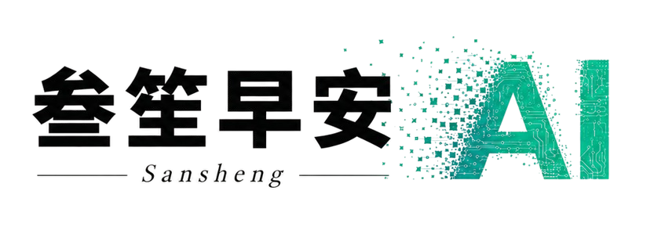
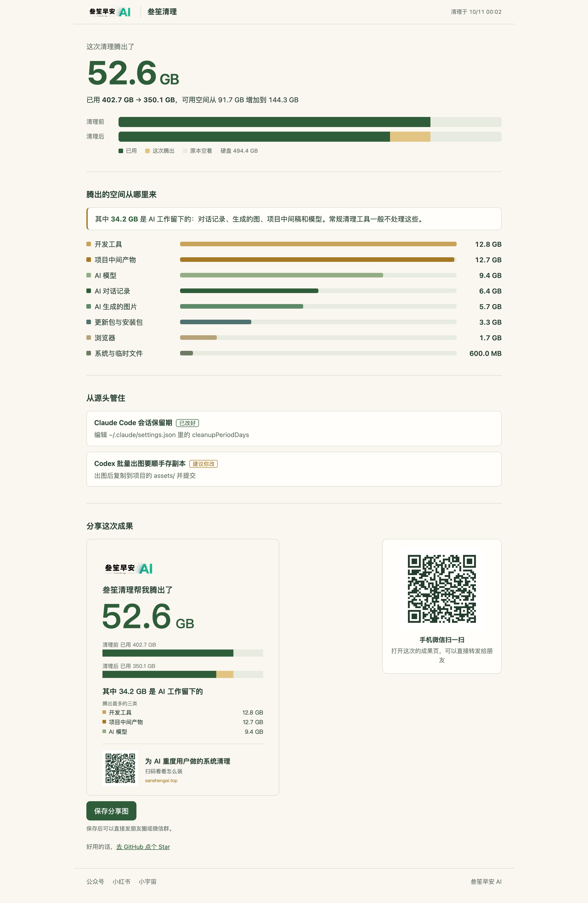
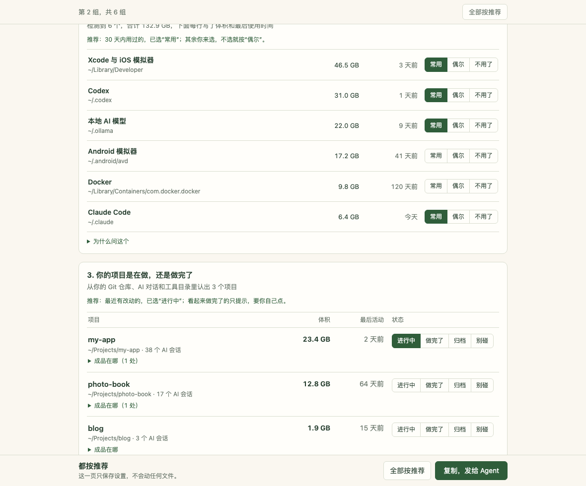
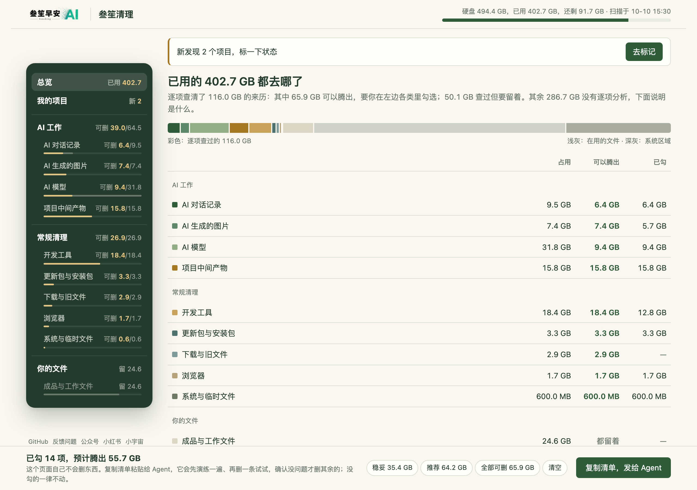
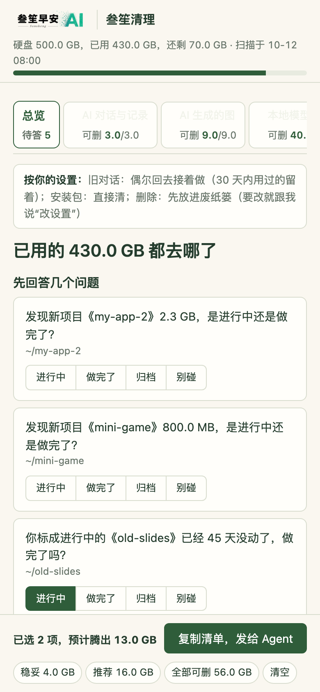

# Sansheng Cleanup · sansheng-disk-cleanup

[中文](./README.md) | **English**

<picture>
  <source media="(prefers-color-scheme: dark)" srcset="assets/logo-dark.png">
  
</picture>

**The disk-cleanup Skill that knows AI junk best**

Months of Codex and Claude Code, and the disk is full with no idea why? General cleaners only know browser caches and logs. AI conversation logs, batch-generated images, project intermediates and model caches are things they neither recognise nor dare to touch. Sansheng Cleanup is built for exactly these.



*Measured on the author's Mac: one run freed 23.9 GB, 21.3 GB of it left behind by AI work: conversation logs 10.1 GB, project intermediates 7.7 GB, generated images 2.0 GB. (The interface is in Chinese.)*

If it helps, please give the [GitHub repository](https://github.com/sanshengai/sansheng-disk-cleanup) a Star first. To install, just send this sentence to your AI agent (Claude Code, Codex or any agent that supports `SKILL.md`):

```text
Please install the Skill from https://github.com/sanshengai/sansheng-disk-cleanup and show me where my disk space went.
```

Current version 0.6.1, macOS only; Windows is not supported yet.

## Three highlights

### It thinks: knows AI junk, checks before deleting

It knows where each AI tool keeps conversations, images and drafts. Before suggesting removal it checks, for every item, **who made it, for which task, whether that task is done, and who still uses it**; if it can't tell, it leaves the item alone. When it meets a large folder it doesn't recognise, it looks inside, works out what it is, and remembers it for next time. Passwords, uncommitted code and conversations in use are protected by the scripts themselves; the AI cannot override that.



*On the author's Mac: 6 AI tools and development environments recognised, 113.3 GB in total; Codex alone takes 73.7 GB.*

### It learns: understands you better each time

The first run is a one-page questionnaire to get to know you: which tools you use often, which projects are done, where your finished work lives, whether deleted items should go to the Trash first. After that it follows your habits, and every cleanup ends with "what I remembered this time"; strike out anything it got wrong. For things that keep growing (an AI tool that keeps every conversation, a script that saves each image several times), it fixes the source with your consent and tells you next time whether the growth really stopped.

### It lets you decide: one board, your call

No terminal output to read: one board shows where the space went, and you tick and click to decide; for small things, just reply "OK" in the chat. Every run starts with a dry run and a one-item pilot, deleted items go to the Trash first, and you get a results page at the end.

| Cleanup board (sample data) | Works on a phone too |
|---|---|
|  |  |

## Also included

- **You decide what it can read**: four levels: basic (project notes, scripts, logs), extended (files received in chat apps, mail attachments, photos and screenshots; names and sizes only), deep (chat text, image content), and never read (passwords, keychains, browser login data, keys; enforced by the scripts). Whatever it reads is sent to the AI service you use, so every results page lists the files read in that run.
- **A third path besides delete and keep**: move to the Trash so you can change your mind; archive finished projects to an external drive, where every file is verified before the original is touched; for iCloud and other cloud folders, only the official "keep it in the cloud" guidance, without touching your files.
- **Safety does not change**: settings and memory only change what it asks and what is pre-selected, **never whether something may be deleted**. No sudo, no background daemons, everything runs locally.
- **Shareable**: the results page can save a share image for social media or group chats.

## First run

1. **Quick look**: a fast scan of about 1 minute to see which tools are installed and which projects exist.
2. **One-page questionnaire**: questions tailored to your machine (no Docker, no Docker question). About 5 minutes for heavy AI users, or one click to accept all recommendations; say "change settings" any time.
3. **Closer look**: following your answers, it reads what it is allowed to read and looks for evidence that projects are done, skipping tools you use often and projects in progress.
4. **Cleanup board**: lists what can be cleaned and what needs your decision, with the reasoning and consequences for each item.
5. **Results page**: how much was freed, which files were read, what it remembered, and what was fixed at the source.

After that, every time: scan → cleanup board (or just reply "OK" in the chat) → results page.

## Manual install

You can also clone it into your agent's Skill directory, for example for Claude Code:

```sh
git clone https://github.com/sanshengai/sansheng-disk-cleanup ~/.claude/skills/sansheng-disk-cleanup
```

Requires Python 3.9+, standard library only; with `rg` installed, reference checks are faster and more thorough. If GitHub is unreachable, a backup package is available on the [website](https://sanshengai.top/tools/disk-cleanup/).

## Why it is needed

Ordinary cleaners look for browser caches, logs and the Trash. On a computer used heavily with AI tools, the big items are elsewhere:

- **Agent sessions**: batch image generation with `codex exec`, for example, stores each image three times. Each session is only a few MB and never rises to the top when sorted by size, yet together they add up.
- **Pipeline intermediates**: video storyboards, illustration drafts, rejected test renders, build outputs, temporary products in multiple worktrees.
- **Models and toolchains**: model weights, emulator images, SDKs, package caches and old program versions.

None of this can be deleted just because it "hasn't been touched for a while" or "has cache in its name". This Skill makes the agent answer four questions for every large item: **who made it, for which task, is the task done, and who still uses it**. Only when all four have evidence does it suggest cleaning; any missing answer becomes a question for you. Once it knows you, it also knows which projects are active, which are done and where finished work lives, so it can check whether a generated image has an identical copy among your finished work.

## How it works

```
quick scan → one-page setup → full scan and closer judgement → check, seal, three tiers → you reply (or pick on the board) → dry run, pilot, real run → results page
```

1. **Scan** (read-only): tallies large directories top-down with git role, whether a process has them open, changes in the last 24 hours, whether other files reference them, and growth since the last scan. Dedicated probes cover Codex, Claude Code, Android, worktrees and Grok, plus the macOS system layer, staged software updates, leftovers of uninstalled apps, and large files untouched for a long time in Downloads, Desktop, Documents and Movies.
2. **Judge**: the agent reads the matching knowledge cards (AI agents, model caches, package managers, Android, Xcode, Docker, worktrees and pipelines, macOS system, browsers, updates and installers, editing/design/music/games, chat and cloud drives, long-unused large files), investigates unrecognised folders within the read permissions, and writes a cleanup plan.
3. **Check and propose**: the scripts validate the plan; anything with insufficient evidence, in use, referenced without explanation, or on a protected path is automatically downgraded to "keep" with the reason. A plan that passes is sealed, with three tiers and a short message for you.
4. **Execute**: only the tier you chose or the cards selected on the board are executed: dry run first, then a one-item pilot, then the real run, stopping at the first anomaly. Where a tool has its own command, that is preferred (e.g. `codex delete`, `sdkmanager --uninstall`, `brew cleanup`).
5. **Results**: space freed is measured item by item, and a results page and share image are generated; your choices are stored locally so it asks less next time. For large folders it could not identify, it asks at the end whether to generate feedback (text with no personal information, never sent automatically).

## Safety boundaries

- No background daemons, no scheduled tasks, no sudo, nothing uploaded.
- You decide the read scope; credentials such as passwords, keychains, browser login data, keys and `.env` files are never read, and every read is logged.
- Credentials, memory, the current session, uncommitted source code and databases being written to are protected by the scripts; the agent cannot override this.
- Chat app history (WeChat, WeCom and so on) is never deleted directly; you are pointed to the app's own cleanup. Cloud folders only get the official "keep it in the cloud" guidance.
- Deletion is file by file, never `rm -rf`, never following symlinks; the Trash is never emptied for you, and archived files are verified one by one.
- Retention settings of tools (such as how many days of sessions to keep) are only suggested and changed with your consent.

More details in [SECURITY.md](SECURITY.md).

## Quick use

With the Skill loaded, say "clean up my disk" or "my disk is almost full". The first time, it sends a one-page setup; after that it scans following [SKILL.md](SKILL.md) and offers three tiers in the chat. To change settings, say "change settings".

You can also run each step by hand:

```sh
python3 scripts/scan.py scan --no-refs                # first time: quick scan, about 1 minute
python3 scripts/scan.py probe projects --run <run-dir> # recognise projects, installed tools and finished-work candidates
python3 scripts/plan.py setup --run <run-dir>          # generate the setup page (add --mode edit to change settings)
python3 scripts/plan.py profile --apply <answers-file> # save your answers from the setup page
python3 scripts/scan.py scan                          # full scan, written to ~/.sansheng/disk-cleanup/runs/<scan_id>/
python3 scripts/scan.py probe codex-groups            # group Codex sessions by source
python3 scripts/scan.py probe item-refs --run <run-dir>  # check references item by item inside large folders
python3 scripts/scan.py probe done-evidence --run <run-dir> --path <dir>  # find evidence a project is done
python3 scripts/peek.py --run <run-dir> <path>          # read a file within your permissions, with a log entry
python3 scripts/plan.py check   --run <run-dir>       # after the agent writes plan.json
python3 scripts/plan.py seal    --run <run-dir>
python3 scripts/plan.py propose --run <run-dir>       # three tiers and a short message
python3 scripts/plan.py board   --run <run-dir>       # generate board.html when the proposal calls for it
python3 scripts/act.py go --run <run-dir> --choice recommended   # dry run → pilot → real run → results page
python3 scripts/act.py go --run <run-dir> --from-board <list-file>  # board path; add --trash for the Trash, --archive-to /Volumes/<disk>/<dir> to archive
python3 scripts/memory.py forget --from-text <file>    # entries struck out under "what I remembered"
python3 scripts/feedback.py gaps --run <run-dir>      # unidentified large folders: generate feedback text only, never sent
```

Local settings, project status, habit rules and memory (finished-work folders, extra reference-check folders, protected paths, read scope, deletion mode and so on) are stored in `~/.sansheng/disk-cleanup/profile.json`, outside the Skill itself. See [references/contract.md](references/contract.md) for the format.

## Documentation

- [SKILL.md](SKILL.md): the agent's procedure and hard constraints
- [references/judgment.md](references/judgment.md): rules for deciding whether a large folder can be cleaned
- [references/cards/](references/cards/): knowledge cards for each kind of item
- [references/contract.md](references/contract.md): data formats and script behaviour for each step
- [SECURITY.md](SECURITY.md): safety boundaries and reporting issues
- [CHANGELOG.md](CHANGELOG.md): version history

These documents are written in Chinese.

## Author and license

Developed by [Sansheng Good Morning AI](https://sanshengai.top), born from a real need to investigate a full disk.

Code and accompanying documentation are licensed under the [MIT License](LICENSE). The bundled QR code library `scripts/vendor/qrcodegen.py` comes from [Project Nayuki](https://www.nayuki.io/page/qr-code-generator-library) (MIT) with its original copyright notice. The official logo and brand rights are reserved separately; see [BRAND.md](BRAND.md) for how the logo may be displayed and redistributed with the original Skill and its generated boards.

If it helps, a GitHub Star is welcome.
